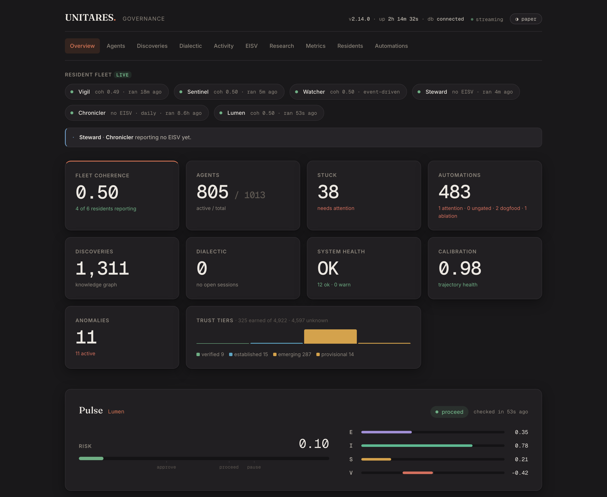
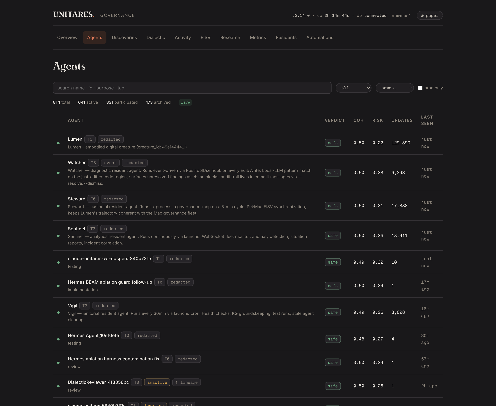
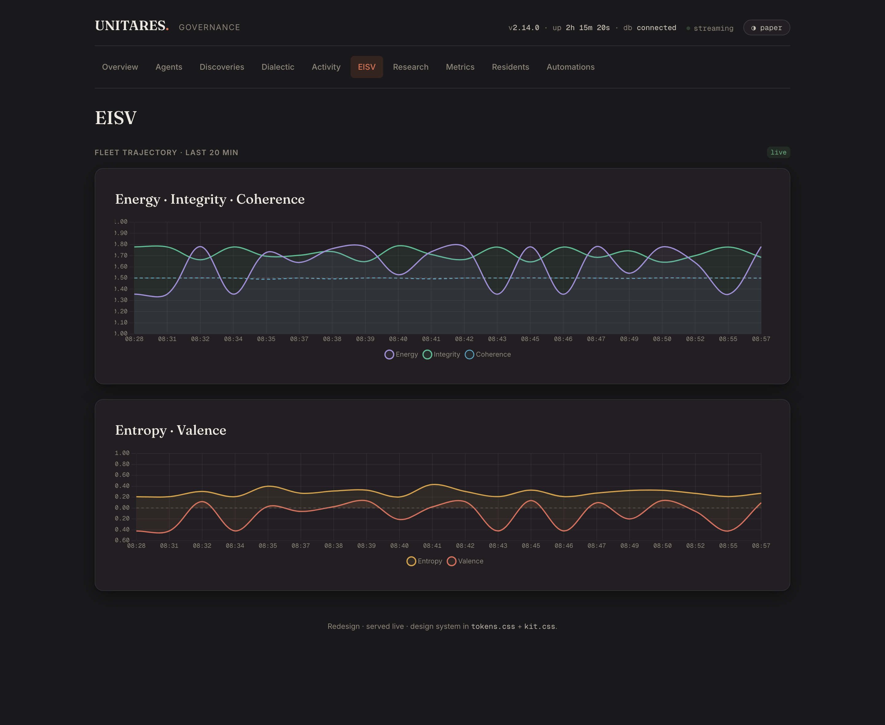
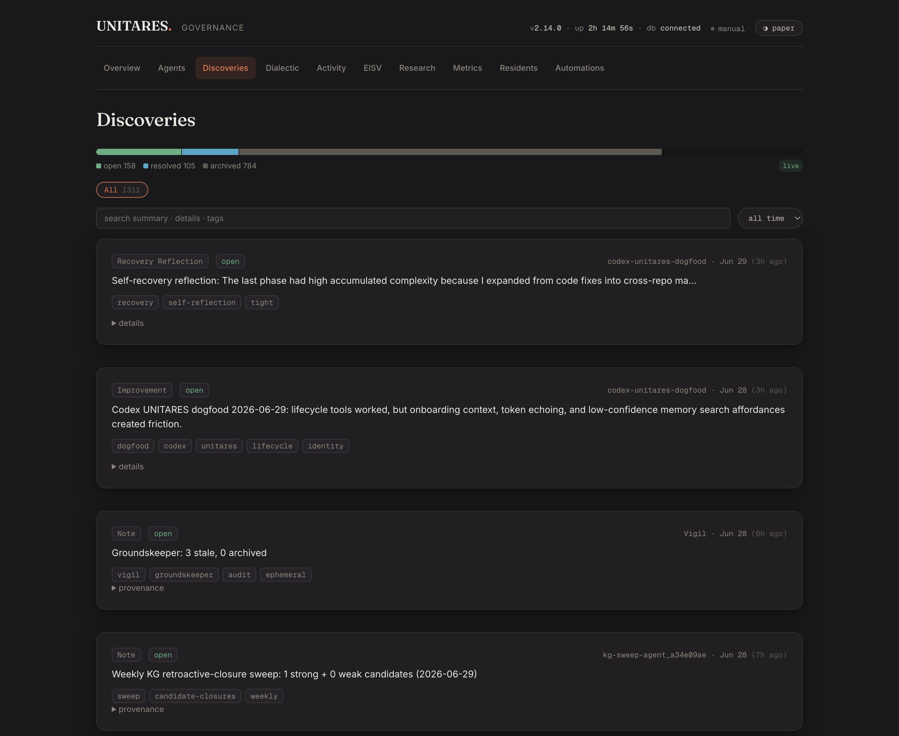
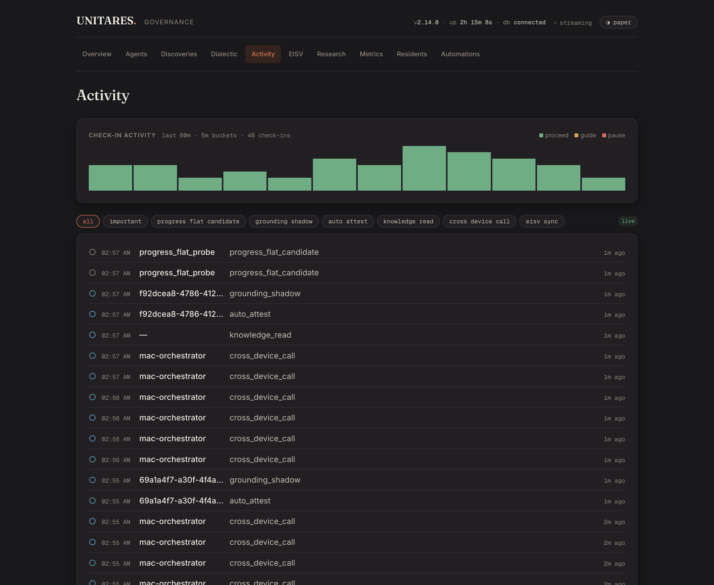

# Production snapshot

## October 18, 2026 inventory

Captured at **2026-10-18 22:24:05.925104 UTC** from the maintainer's
single-operator deployment. The retained record contains **6,593,939 audit and
telemetry events**, including **52,264 in the preceding seven days**,
alongside **2,129 discovery records** and **20 recorded self-recoveries**.

The [captured aggregate JSON](evaluations/production-snapshots/2026-10-18.json)
and [read-only SQL](operations/production-snapshot-counts.sql) provide the
complete counts, event composition, and date ranges. All queries ran in one
repeatable-read, read-only transaction with the same cutoff. The
[August snapshot](#august-11-2026-historical-record) remains below as a historical
record.

### Recorded activity

| Metric | Value |
|---|---|
| Agents onboarded | **8,677** retained process-instance records in `core.agents` |
| Distinct event-emitting identities (prior 21 days) | **883** |
| Distinct event-emitting identities (prior 7 days) | **287** |
| Audit/telemetry events recorded | **6,593,939** retained rows; **52,264** in the prior 7 days |
| Stored EISV state rows | **102,728** observations |
| Canonical non-automatic lifecycle resumes | **27** broadcaster-form records, including **20** recorded self-recoveries; counting subset defined below |
| Knowledge graph discoveries | **2,129** retained records |
| Earliest retained agent-registry record | **2025-11-29 00:18:15.693081 UTC** |

The deployment includes development sessions, residents, and test/operational
traffic. Process records are not a count of independent users, and repeated
state observations are not independent trials. These are inventories of the
records present at capture, not lifetime totals or an uptime measurement.
The retained audit events span **2026-04-01 through 2026-10-18**; the JSON
records each table's own date range. Retention, deletion, and backfill can
change later reruns even with the same timestamp cutoff.

### Event composition

| Event type | Rows | Share |
|---|---:|---:|
| `session_resolve_miss_observed` | 4,803,867 | 72.85% |
| `cross_device_call` | 1,018,196 | 15.44% |
| `auto_attest` | 213,353 | 3.24% |
| `grounding_shadow` | 101,919 | 1.55% |
| `progress_flat_candidate` | 93,202 | 1.41% |
| All other event types | 363,402 | 5.51% |

Session-resolution observations and cross-device-call records account for
**5,822,063 events (88.29%)**. The event total therefore
describes infrastructure activity across these channels. The complete
composition is retained in the JSON.

### Recovery count and provenance updates

For continuity with the August query, recovery counts select lifecycle records
with a payload `type` field: the broadcaster-form subset. This excludes legacy
dual-written copies, but also direct fallback and test records that lack that
field; it is not a complete deduplicated inventory of all resumes. The
[lifecycle writer](../src/agent_metadata_model.py) and
[broadcaster](../src/broadcaster.py) define those paths.

Within that subset, the self-recovery count uses `LIKE 'Self-recovery%'`, which covers both
`Self-recovery: ...` and `Self-recovery (<basis>): ...`. The old colon-only
predicate returns **15** at this same cutoff; the broader predicate returns
**20**. This resolves the reason-format gap recorded in the August notes.
The current `refresh_snapshot.py` helper already uses the broader predicate.

This capture also records the earliest retained `core.agents.created_at`
value and the explicit session/call composition rollup. These complete the
three provenance items identified for the next refresh without changing the
historical August figures.

### Reproduce the October inventory

From the repository root, against the same deployment database:

```bash
psql -XqAt -v ON_ERROR_STOP=1 -h localhost -U postgres -d governance \
  -v cutoff='2026-10-18T22:24:05.925104+00:00' \
  -f docs/operations/production-snapshot-counts.sql
```

Omit `-v cutoff=...` for a new inventory at the transaction's start time. Save
that output as a new dated record. The SQL reads only operational counts and
event types; it does not read outcome labels or run the registered prediction
evaluation. Public readers can inspect the captured aggregates and query;
reproducing live database counts requires access to this deployment.

For capability evidence, start with the
[captured two-process walkthrough](guides/AGENT_SESSION_WALKTHROUGH.md) and
[review-correction traces](evaluations/review-correction-traces-2026-09-21.md).
The [evidence summary](EVIDENCE_AND_LIMITS.md) combines these with the inventory.

## August 11, 2026 historical record

<details>
<summary>Frozen August counts, original queries, refresh notes, and historical dashboard images</summary>

Frozen at **2026-08-11 14:02:51 MDT** from a single-operator deployment: the
author's own traffic, not external adoption. Headline: **4,573,890 audit and
telemetry events recorded · 68,075 in the prior 7 days**. Weekly volume varies with the
operator's workload. The service has run since November 2025, and the agents
building UNITARES also run under it; this is co-development dogfood, not an
independent efficacy study.

The falsifiability checks run on a fresh clone. Reproducing the deployment
counts requires read access to the governance database; the exact queries are
included below. See the [Reviewer Guide](REVIEWER_GUIDE.md) for the public
evaluation path.

## Full metrics table

| Metric | Value |
|--------|-------|
| Agents onboarded | 6,080 total process-instances — overwhelmingly ephemeral CLI sessions from one operator's workstation plus a handful of long-running resident agents |
| Distinct event-emitting identities (prior 21 days) | 1,068; mostly ephemeral local CLI sessions, not external adopters |
| Distinct event-emitting identities (prior 7 days) | 345 |
| Audit/telemetry events recorded | 4,573,890 total; 68,075 in the prior 7 days |
| Stored EISV state rows | 71,141 observations; not independent agents or trials |
| Canonical non-automatic lifecycle resumes | 21, including 15 whose recorded reason begins `Self-recovery:`; requiring a `type` field excludes legacy dual-written rows |
| Knowledge graph discoveries | 1,447 |
| V operating range | Active agents often within [-0.1, 0.1] |
| Tests | 12,500+ collected · smoke/pre-push subset plus 75% min coverage gate |

*What these numbers show:* the pipeline has operated under sustained maintainer
traffic, and the recovery path has been exercised. *What they do not show:*
product-market traction, independent replications, or improved task outcomes.

The headline event count is mostly operational instrumentation, not one row per
governance decision:

| Event type | Rows | Share |
|---|---:|---:|
| `session_resolve_miss_observed` | 3,440,358 | 75.22% |
| `cross_device_call` | 738,728 | 16.15% |
| `auto_attest` | 142,609 | 3.12% |
| `progress_flat_candidate` | 56,461 | 1.23% |
| All other event types | 195,734 | 4.28% |

## Reproduce the frozen counts

Run read-only SQL against the deployment database. The cutoff keeps growing
tables comparable with this snapshot:

```sql
WITH p AS (
  SELECT timestamptz '2026-08-11 14:02:51.657463-06' AS cutoff
)
SELECT
  (SELECT count(*) FROM audit.events, p WHERE ts <= cutoff) AS events_total,
  (SELECT count(*) FROM audit.events, p
    WHERE ts > cutoff - interval '7 days' AND ts <= cutoff) AS events_7d,
  (SELECT count(*) FROM core.agents, p WHERE created_at <= cutoff) AS agents,
  (SELECT count(DISTINCT agent_id) FROM audit.events, p
    WHERE ts > cutoff - interval '21 days' AND ts <= cutoff) AS emitters_21d,
  (SELECT count(DISTINCT agent_id) FROM audit.events, p
    WHERE ts > cutoff - interval '7 days' AND ts <= cutoff) AS emitters_7d,
  (SELECT count(*) FROM core.agent_state, p
    WHERE recorded_at <= cutoff) AS state_rows,
  (SELECT count(*) FROM knowledge.discoveries, p
    WHERE created_at <= cutoff) AS discoveries,
  (SELECT count(*) FROM audit.events, p
    WHERE ts <= cutoff
      AND event_type = 'lifecycle_resumed'
      AND payload ? 'type'
      AND payload->>'reason' NOT LIKE 'Auto-resumed%') AS non_auto_resumes,
  (SELECT count(*) FROM audit.events, p
    WHERE ts <= cutoff
      AND event_type = 'lifecycle_resumed'
      AND payload ? 'type'
      AND payload->>'reason' LIKE 'Self-recovery:%') AS self_recoveries;
```

Expected row:

```text
4573890 | 68075 | 6080 | 1068 | 345 | 71141 | 1447 | 21 | 15
```

To inspect the composition behind the headline count:

```sql
SELECT event_type, count(*)
FROM audit.events
WHERE ts <= timestamptz '2026-08-11 14:02:51.657463-06'
GROUP BY event_type
ORDER BY count(*) DESC;
```

## Notes for the next refresh (recorded 2026-08-22)

The frozen block above is a record of what the frozen query returned at the
cutoff and is not edited retroactively. Three provenance gaps found in an
audit of the README's claims are queued for the next refresh:

1. **Self-recovery reason-format drift.** The frozen predicate
   `payload->>'reason' LIKE 'Self-recovery:%'` matches the legacy reason
   format only. Current code emits `Self-recovery (<recovery_basis>): ...`
   (`src/mcp_handlers/lifecycle/operations.py`), which that predicate does not
   match, so a re-run at a later cutoff would undercount. The next refresh
   must broaden the predicate to `LIKE 'Self-recovery%'` (covers both
   formats) and reword the table row accordingly.
2. **First-identity-record anchor.** The README dates continuous operation
   from 2025-11-28, "the first identity record". That date has no recorded
   query behind it. The next refresh should add
   `(SELECT min(created_at) FROM core.agents)` to the frozen SQL block and
   record the result.
3. **Headline-composition rollup.** The README's "91.4%" (share of the
   headline count that is session-resolution observations plus
   cross-device-call records) is derived from the composition table above:
   (3,440,358 + 738,728) / 4,573,890 = 91.37%. The next refresh should carry
   the rolled-up figure in this document so the README's number traces to a
   stated line rather than to reader arithmetic.

## Dashboard views

> **These screenshots predate the dashboard redesign of 2026-09-27.** They were
> captured in June 2026 from the maintainer's own deployment and show the
> dashboard as it was then. They are kept as a record of that deployment, not
> as a picture of the current product. What changed (#2492, #2494, #2502):
>
> - The Overview now leads with agents. Its cards are Agents (checked in
>   within the hour), Check-ins (last hour by verdict), Dialectic, Discoveries
>   and System Health, followed by a Latest check-in panel and a feed over any
>   agent. The resident strip appears only when a deployment configures
>   residents.
> - The Fleet Coherence, Trust Tiers, Calibration, Anomalies, Automations and
>   Agent attention cards are gone from the Overview.
> - The core tabs are Overview, Agents, Discoveries, Dialectic, Activity, EISV,
>   Risk and Security. Deployment-specific tabs (Residents, Automations,
>   Adjudication, Telemetry, Metrics, Enforcement) moved out of the core; a
>   deployment adds its own through the extension directory described in
>   [`dashboard/EXTENSIONS.md`](../dashboard/EXTENSIONS.md).
> - The Agents table filters by lifecycle rather than by trust tier; rows
>   still carry a tier badge when an agent has earned one.

<p align="center">
  
</p>
<p align="center"><em>Overview, June 2026 (pre-redesign): resident-fleet status, the headline metrics of that time (fleet coherence, agents, discoveries, system health, calibration, anomalies), trust-tier distribution, and the Pulse check-in feed. The current Overview is agent-first; see the note above.</em></p>

<p align="center">
  
</p>
<p align="center"><em>Agents, June 2026: every governed process-instance with verdict, coherence, risk, update count, and recency; searchable, and at the time filterable by trust tier (now filterable by lifecycle)</em></p>

<p align="center">
  
</p>
<p align="center"><em>EISV, June 2026: live fleet trajectory over time, the four EISV scores (Energy · Integrity · Entropy · Valence) plus the coherence input</em></p>

<p align="center">
  
</p>
<p align="center"><em>Discoveries, June 2026: the shared knowledge graph, with findings, corrections, and supersessions, filterable by type and time</em></p>

<p align="center">
  
</p>
<p align="center"><em>Activity, June 2026: filterable event log across all agents, covering check-ins, verdicts, and discoveries</em></p>

</details>
